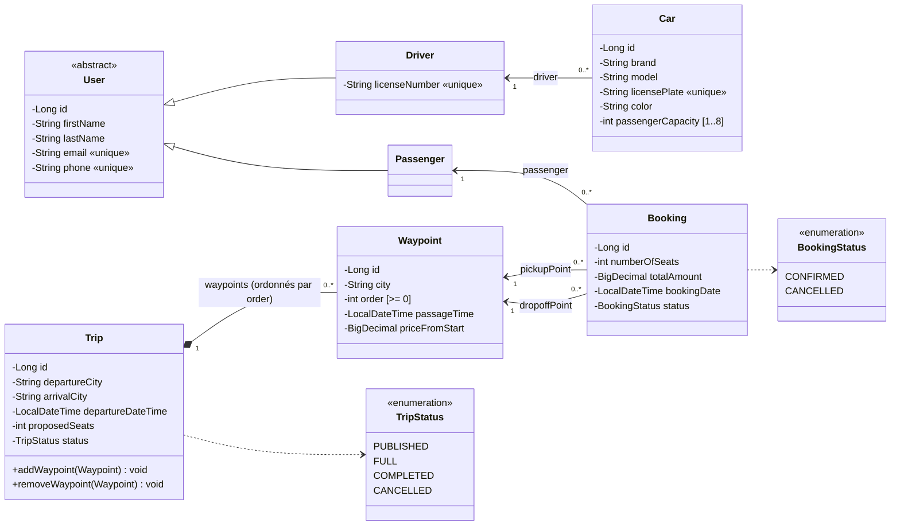

# RideFlow — Diagramme de classes UML (modèle de données)

Généré à partir des entités JPA de `src/main/java/ma/youcode/rideflow/feature/**/model`.

## Tables (héritage JOINED)

| Entité | Table | Clés étrangères |
|---|---|---|
| User (abstract) | `users` | — |
| Driver | `drivers` | `id` → `users.id` |
| Passenger | `passengers` | `id` → `users.id` |
| Car | `cars` | `driver_id` → `drivers.id` |
| Trip | `trips` | — |
| Waypoint | `waypoints` | `trip_id` → `trips.id` |
| Booking | `bookings` | `passenger_id`, `pickup_point_id`, `dropoff_point_id` |
